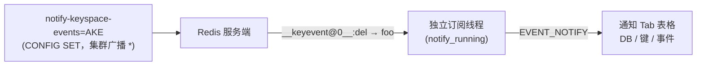

# 35. 键空间 / 键事件通知（通知 Tab）

> **实现状态**：待实现（方案已定稿，等排期）
> **关联 backlog**：[`future.md`](../../docs/zh/changelog/future.md) L3「通知: 新的标签页，键空间通知和键事件通知」、L17「Redisson 的键空间通知 模块 参考实现」
> **对标**：Redisee / RedisInsight 的通知视图；参考 [键空间通知文档](https://redis.ac.cn/docs/latest/develop/use/keyspace-notifications/)
> **参考现有实现**：发布订阅 Tab（[`RedisPubsub.vue`](../../src/views/tab/RedisPubsub.vue) + [`client/ops/pubsub.rs`](../../src-tauri/src/client/ops/pubsub.rs)），通知本质就是一组固定频道的 `PSUBSCRIBE`
> **关键代码（预期）**：[`TabMain.vue`](../../src/views/TabMain.vue)、新建 `src/views/tab/RedisNotify.vue`；后端新建 [`client/ops/notify.rs`](../../src-tauri/src/client/ops/)、`NotifyEvent`（[`model.rs`](../../src-tauri/src/model.rs)）、`notify_running`（[`state.rs`](../../src-tauri/src/client/state.rs)）；配置开关复用已有 `config_get` / `config_set`

> 目标：连接页新增「通知」Tab，一键开启服务端 `notify-keyspace-events`，订阅 `__keyspace@<db>__:*` / `__keyevent@<db>__:*` 频道，把频道名与消息解析成 **DB / 键 / 事件** 表格展示。走**独立订阅通道**（不复用发布订阅的 `subscribe_running`），可与发布订阅 Tab 同时运行；集群**订阅所有主节点**并**广播配置**。首版不做键值解码与点击跳转，留到 35.3。

---

## 一、功能与原理

### 1.1 什么是键空间通知

Redis 允许把「键上发生了什么」通过 Pub/Sub 广播出来，由服务端配置 `notify-keyspace-events` 控制。默认**关闭**（空串），因为对多数场景是额外开销。开启后，一次 `DEL foo`（db0）会发两条：

```text
PUBLISH __keyspace@0__:foo del      # 键空间视角：以「键」为频道，消息是「事件名」
PUBLISH __keyevent@0__:del foo      # 键事件视角：以「事件名」为频道，消息是「键」
```

两类频道是**同一事件的两种视角**，信息等价，解析后都能得到 `(db=0, key=foo, event=del)`。

### 1.2 `notify-keyspace-events` 的 flag 语义

配置串由若干字符组成，**必须至少含 K 或 E 之一，且至少含一个事件类别**，否则什么都不发。

| 字符 | 含义                                      | 字符 | 含义                             |
| ---- | ----------------------------------------- | ---- | -------------------------------- |
| `K`  | 开启 `__keyspace@<db>__` 前缀频道         | `x`  | 过期事件（key 到期删除）         |
| `E`  | 开启 `__keyevent@<db>__` 前缀频道         | `e`  | 驱逐事件（maxmemory 淘汰）       |
| `g`  | 通用命令（DEL / EXPIRE / RENAME …）       | `n`  | 新键事件（**不在** `A` 内）      |
| `$`  | String 命令                               | `m`  | key-miss 事件（**不在** `A` 内） |
| `l`  | List 命令                                 | `t`  | Stream 命令                      |
| `s`  | Set 命令                                  | `d`  | 模块键类型事件                   |
| `h`  | Hash 命令                                 | `z`  | Sorted Set 命令                  |
| `A`  | `g$lshzxetd` 的别名（所有类别，不含 n/m） |      |                                  |

> Redis 8.x 起还新增 `o`（覆写）、`c`（类型变更）以及 Subkeyspace 系列 `S/T/I/V`（见 [`Redis8.8.conf`](../../src/assets/conf/Redis8.8.conf)）。首版预设不覆盖这些，走「自定义」输入即可。

常用组合：`AKE`（所有事件 + 两种视角）、`Ex`（只看过期）、`Kg`（只看键空间的通用命令）。

### 1.3 与发布订阅 Tab 的关系与差异

| 维度     | 发布订阅 Tab                                                                                    | 通知 Tab                                     |
| -------- | ----------------------------------------------------------------------------------------------- | -------------------------------------------- |
| 频道     | 用户任意输入的 glob                                                                             | 固定 `__keyspace@` / `__keyevent@` 两族      |
| 前置条件 | 无                                                                                              | 服务端 `notify-keyspace-events` 必须非空     |
| 展示     | 原始 channel / message                                                                          | 解析后的 DB / 键 / 事件                      |
| 集群     | 只连**种子节点**一条（[`me_cluster.rs`](../../src-tauri/src/client/me_cluster.rs) `subscribe`） | 事件按**节点本地**产生，需订阅**所有主节点** |
| 是否可写 | 有「发布」footer                                                                                | 只读观测，无发布                             |

结论：**不复用** `subscribe` 通道。两者共用一个 `subscribe_running` 会互相顶掉、且集群单节点订阅收不全通知。走独立通道后二者可同时开。



---

## 二、竞品 / 参考

| 产品               | 是否支持       | 怎么做                                                 | 对 RedisME 的启示                                                                       |
| ------------------ | -------------- | ------------------------------------------------------ | --------------------------------------------------------------------------------------- |
| **Redisee**        | 有             | 独立通知视图，展示键事件流                             | `future.md` L3 直接点名对标，形态参照                                                   |
| **RedisInsight**   | 有（工作区内） | 键空间通知的订阅与展示                                 | 交互参照，但不照搬其重工作区                                                            |
| **Redisson**       | 有（SDK 侧）   | `RTopic` + `__keyevent@` 监听过期/删除，做本地缓存失效 | `future.md` L17 的「参考实现」，属**客户端库**用法，非 GUI；35.3 再看是否借鉴其事件分类 |
| **本仓库发布订阅** | 已有           | `PSUBSCRIBE` + 后台线程 emit                           | **直接参照**其线程/事件/停止机制                                                        |

---

## 三、决策摘要

| 项       | 结论                                                                                                                                         |
| -------- | -------------------------------------------------------------------------------------------------------------------------------------------- |
| 形态     | 连接页新 Tab `notify`，与 `pubsub` / `monitor` 同级；极简模式隐藏（[`TabMain.vue`](../../src/views/TabMain.vue) `v-if="!minimalMode"`）      |
| 订阅通道 | **独立**：新增 `notify_running` / `EVENT_NOTIFY` / `NotifyEvent` / `client/ops/notify.rs`，不复用 `subscribe_running`，可与发布订阅并行      |
| 事件模型 | 后端解析成 `NotifyEvent { id, datetime, node, db, key, event }`；前端不再拆字符串                                                            |
| 视角     | 一次只订一族：键事件 `__keyevent@*__:*`（默认）/ 键空间 `__keyspace@*__:*`；避免 K+E 同开时同一事件重复成两行                                |
| DB 范围  | 用 `@*` 通配所有库，单列 DB 展示；切库无需重订                                                                                               |
| 配置开关 | 打开页 `config_get` 读现值并展示；预设 `AKE` / `Ex` + 自定义；「开启」二次确认 + 开销警告；「关闭」置空串                                    |
| 集群配置 | `config_set(key, val, "*")` 广播所有节点（已有能力，见 [`me_cluster.rs`](../../src-tauri/src/client/me_cluster.rs) `config_set`）            |
| 集群订阅 | 遍历所有 master，各开一条专用连接、各起一个线程，共用一个 `notify_running`                                                                   |
| 停止机制 | 沿用发布订阅做法：停止频道**必须并入** `PSUBSCRIBE` 模式才能唤醒阻塞的 `recv`；停止时置 flag + 向停止频道发一条；emit 前**过滤**停止频道消息 |
| 只读连接 | 隐藏配置控制与开关（同发布订阅 footer `v-if="canEdit"`），仅可订阅查看                                                                       |
| 能力探测 | 不新增 capability（`notify-keyspace-events` 自 Redis 2.8 起通用）；`CONFIG GET/SET` 被 ACL 限制时按错误提示降级                              |
| 延后     | 见 §十二                                                                                                                                     |

---

## 四、RedisME 现状缺口

- 连接页 Tab 只有 info / value / terminal / search / memory / slow / monitor / pubsub / chart，没有 notify（[`TabMain.vue`](../../src/views/TabMain.vue)）。
- 无 `NotifyEvent` 模型、无 `EVENT_NOTIFY` / `REDIS_ME_NOTIFY_STOP_CHANNEL` 常量（[`support/util.rs`](../../src-tauri/src/support/util.rs) 现仅有 `EVENT_SUBSCRIBE` / `EVENT_MONITOR` 等）、`MeBase` 无 `notify_running`（[`state.rs`](../../src-tauri/src/client/state.rs)）。
- **已具备、可直接复用**：
  - `config_get(pattern, node)` / `config_set(key, value, node)`，集群 `node="*"` 已能广播所有节点（[`api.rs`](../../src-tauri/src/api.rs) L62-63、[`me_cluster.rs`](../../src-tauri/src/client/me_cluster.rs) `config_set`）。
  - `notify-keyspace-events` 的配置说明已在 [`locales/config`](../../src/locales/config/en.ts) 收录。
  - 发布订阅的线程/事件/停止范式（[`client/ops/pubsub.rs`](../../src-tauri/src/client/ops/pubsub.rs) `subscribe0` / `subscribe_stop0`）可原样镜像。
  - 集群单节点旁路连接范式（[`me_cluster.rs`](../../src-tauri/src/client/me_cluster.rs) `monitor` / `subscribe`：`get_client_single` + host/port 覆盖 + 复用 SSH dialer + 读写超时置 None）。
  - `MeTable`、`MeWebsite`、`NodeList`、`listen(event)` 前端范式。

---

## 五、命令契约

### 5.1 配置读写

| 动作   | 命令                                        | 集群路由                                                     |
| ------ | ------------------------------------------- | ------------------------------------------------------------ |
| 读现值 | `CONFIG GET notify-keyspace-events`         | 读一个节点即可（各节点应一致；不一致时以所读节点为准并提示） |
| 开启   | `CONFIG SET notify-keyspace-events <flags>` | `node="*"` 广播所有节点，`ResponsePolicy::AllSucceeded`      |
| 关闭   | `CONFIG SET notify-keyspace-events ""`      | 同上广播                                                     |

> `CONFIG SET` 只改运行时，不写配置文件，重启失效——文档需向用户点明。`CONFIG REWRITE` 不在首版范围。

### 5.2 订阅与解析

订阅读（在专用连接上）：

```text
PSUBSCRIBE <perspective-pattern> REDIS_ME_NOTIFY_STOP_CHANNEL
```

- `perspective=keyevent` → `__keyevent@*__:*`
- `perspective=keyspace` → `__keyspace@*__:*`
- 追加停止频道用于唤醒（同发布订阅 `psubscribe_patterns`）。

解析规则（纯函数 `parse_notify_channel`，需单元测试）：

| 频道形态                       | payload   | 解析结果                                    |
| ------------------------------ | --------- | ------------------------------------------- |
| `__keyspace@<db>__:<key>`      | `<event>` | `db=<db>`, `key=<key>`, `event=<payload>`   |
| `__keyevent@<db>__:<event>`    | `<key>`   | `db=<db>`, `event=<event>`, `key=<payload>` |
| `REDIS_ME_NOTIFY_STOP_CHANNEL` | 任意      | 返回 `None`（不 emit，仅唤醒）              |
| 其它无法识别                   | —         | 返回 `None`（丢弃，不污染表格）             |

- `<db>` 从频道 `@` 与 `__` 之间截取，解析失败按 0。
- `<key>` 可能是二进制/非 UTF-8：走 `vec8_to_display_string`（同发布订阅 payload 处理），不强行 UTF-8。

### 5.3 集群订阅拓扑

```text
单机:  当前 host:port 开 1 条专用连接，起 1 个线程
集群:  对每个 master 各开 1 条专用连接（host/port 覆盖，复用 SSH dialer），各起 1 个线程
       所有线程共用一个 notify_running；emit 时带上 node 标签
停止:  notify_running=false + 向停止频道 PUBLISH 一条
       （集群常规 PUBLISH 会在节点间传播，理论上一条即可唤醒全部；实现时对每条连接各发一次更稳妥）
```

> **需实测**：集群下键空间通知是否随常规 Pub/Sub 在节点间传播（若传播，单节点订阅即可收全；若不传播，必须全 master 订阅）。方案按**全 master 订阅**实现以保稳健，实测结论写入本节。

---

## 六、后端设计（逐文件）

1. **[`model.rs`](../../src-tauri/src/model.rs)**：新增

   ```rust
   api_model!(NotifyEvent {
       id: String,        // 连接 id，前端按此过滤
       datetime: String,  // 与 SubscribeEvent 同格式
       node: String,      // 集群节点地址；单机为空串
       db: u16,           // 解析自频道
       key: String,       // 解析后的键（display string）
       event: String,     // 事件名，如 del / set / expired
   });
   ```

   可选新增订阅参数模型：

   ```rust
   api_model!(NotifySubscribeParam {
       perspective: String,   // keyevent | keyspace
       db: Option<u16>,       // None = 所有库（@*）
   });
   ```

2. **[`support/util.rs`](../../src-tauri/src/support/util.rs)**：新增常量 `EVENT_NOTIFY = "notify"`、`REDIS_ME_NOTIFY_STOP_CHANNEL = "REDIS_ME_NOTIFY_STOP_CHANNEL"`（与订阅停止频道分开，避免与发布订阅串扰）。

3. **[`client/state.rs`](../../src-tauri/src/client/state.rs)**：`MeBase` 增 `notify_running: Arc<AtomicBool>`，`From<&ConnConfig>` 里初始化为 `false`。

4. **新建 [`client/ops/notify.rs`](../../src-tauri/src/client/ops/)**（并在 [`client/ops.rs`](../../src-tauri/src/client/ops.rs) 加 `pub mod notify;`）：
   - `notify_subscribe_node0(conn, running, app_handle, patterns, id, node, logger)`：镜像 `subscribe0`，后台线程 `recv_response` → `Msg` → `parse_notify_channel` → `emit(EVENT_NOTIFY, NotifyEvent)`；停止频道/无法解析的消息跳过。
   - `notify_subscribe_stop0(conn, running)`：镜像 `subscribe_stop0`，`running=false` + 向 `REDIS_ME_NOTIFY_STOP_CHANNEL` 发一条唤醒。
   - `build_notify_patterns(perspective, db) -> Vec<String>`：拼视角模式 + 追加停止频道。
   - `parse_notify_channel(channel, payload) -> Option<(u16, String, String)>`：纯函数 + `#[cfg(test)]` 覆盖 keyspace / keyevent / 停止频道 / 非法频道 / 二进制键。

5. **[`client/me_client.rs`](../../src-tauri/src/client/me_client.rs)**：trait 增

   ```rust
   fn notify_subscribe(&self, param: NotifySubscribeParam) -> AnyResult<()>;
   fn notify_subscribe_stop(&self) -> AnyResult<()>;
   ```

6. **[`client/me_single.rs`](../../src-tauri/src/client/me_single.rs)**：`notify_subscribe` 开 1 条专用连接（同 `subscribe`：`get_connection_with_timeout`），`node` 传空串，调 `notify_subscribe_node0`；`Drop` 里若 `notify_running` 为真则调 `notify_subscribe_stop`。

7. **[`client/me_cluster.rs`](../../src-tauri/src/client/me_cluster.rs)**：`notify_subscribe` 遍历 `get_node_list_master()`，对每个 master 复制 `conf` 覆盖 host/port（同 `monitor`），各开连接、各调 `notify_subscribe_node0`（`node` 传该节点地址），全部共用 `notify_running`；`Drop` 同上处理。

8. **[`support/macros.rs`](../../src-tauri/src/support/macros.rs)** `me_client_forwards!`：加 `notify_subscribe_stop`（单机/集群一致：置 flag + 发停止频道，用 `get_conn()`）。`notify_subscribe` 两端不同，**不进宏**，各自 impl。

9. **[`api.rs`](../../src-tauri/src/api.rs)** `api_commands!`：加

   ```rust
   notify_subscribe(param: NotifySubscribeParam) -> ();   // 需要 app_handle，放宏的下半区
   notify_subscribe_stop() -> ();
   ```

10. **[`lib.rs`](../../src-tauri/src/lib.rs)**：`tauri_specta_commands!` 注册 `notify_subscribe` / `notify_subscribe_stop`；`export_tauri_specta_typescript_bindings` 测试重生成 [`src/types/tauri-specta.ts`](../../src/types/tauri-specta.ts)。

---

## 七、前端设计（逐文件）

1. **[`TabMain.vue`](../../src/views/TabMain.vue)**：在 `pubsub` 之后加

   ```vue
   <me-tab-pane name="notify" icon="me-icon-notify" lazy>
     <RedisNotify />
   </me-tab-pane>
   ```

   置于 `v-if="!minimalMode"` 的 `<template>` 内。

2. **新建 `src/views/tab/RedisNotify.vue`**（镜像 [`RedisPubsub.vue`](../../src/views/tab/RedisPubsub.vue)）：
   - 状态：`perspective`（默认 `keyevent`）、`keyword`、`subscribing`、`configValue`（当前 `notify-keyspace-events`）、`dataList`。
   - 打开时 `meCommands.configGet(id, 'notify-keyspace-events', node)` 拉现值。
   - 订阅/停止：`listen<NotifyRow>('notify')` 按 `payload.id === share.conn.id` 过滤后 `push`；`meCommands.notifySubscribe(id, { perspective, db: null })` / `meCommands.notifySubscribeStop(id)`；`onUnmounted` 解绑。
   - 列：时间 | 节点 | DB | 键 | 事件 | 操作（复制键 / 复制事件）；`default-sort` 时间降序；`export-name="notify"`。
   - 配置控制：状态 chip（空值红色「未开启」/ 有值绿色显示 flag 串）+ popover（预设 `AKE` / `Ex` + 自定义输入 + 开启/关闭）；`meConfirm` 二次确认 + 开销警告；只读连接隐藏（`v-if="canEdit"`）。
   - 视角选择器：`el-select`（键事件 / 键空间），`subscribing` 时禁用。
   - `me-website to="notify"`。

3. **[`components/MeWebsite.vue`](../../src/components/MeWebsite.vue)**：`DOC_PATHS` 加

   ```ts
   notify: {
     redis: '/docs/latest/develop/use/keyspace-notifications/',
     valkey: '/topics/notifications/',
   },
   ```

4. **i18n（[`zh-cn.ts`](../../src/locales/lang/zh-cn.ts) / [`en.ts`](../../src/locales/lang/en.ts)）**：
   - `tabMain.notify`：`通知` / `Notify`。
   - 新增 `redisNotify` 段：`configStatus` / `configEmpty` / `enable` / `disable` / `enableConfirm`（开销警告文案）/ `presetAll` / `presetExpired` / `custom` / `perspective` / `keyevent` / `keyspace` / `subscribeStart` / `subscribeStop` / `subscribeStarted` / `subscribeStopped` / `clearMessage` / `keyword` / `datetime` / `node` / `db` / `key` / `event`。

5. **图标**：新增 `src/assets/icons/notify.svg`（铃铛类），经 `me-icon-notify` 引用；若暂不出图，先复用 `me-icon-pubsub`。

---

## 八、UI 结构（ASCII 草图）

```text
通知 Tab（工具栏左右分开，与发布订阅/监控一致）
┌ [🗑清空] [配置:未开启▾]  视角[键事件▾]  🔗         [筛选____] [订阅] ┐
│  时间 │ 节点 │ DB │ 键 │ 事件 │ 操作                              │
│  ..   │ ..   │ 0  │foo │ del  │ 📋                                │
└──────────────────────────────────────────────────────────────────┘

配置 popover（点「配置」chip）
┌ 当前: (空) ──────────────────────┐
│ 预设: [AKE 全部] [Ex 仅过期]      │
│ 自定义: [__________]              │
│ [开启(二次确认+开销警告)] [关闭]  │
└──────────────────────────────────┘
```

---

## 九、分阶段验收

每阶段：**实现 → 手工验收 → 单独 commit**（一行标题，无 body）。完成后勾 [`future.md`](../../docs/zh/changelog/future.md) 对应条目。环境：本地 Redis（可 `CONFIG SET`）+ 一个 3 主集群；另备一个 ACL 限制 `CONFIG` 的实例看降级文案。

### 35.1 单机：独立订阅 + 解析表格 + 配置一键开关

**做：**

- [`TabMain.vue`](../../src/views/TabMain.vue) 增 `notify`（极简模式不显示）
- 后端独立通道：`NotifyEvent` / `EVENT_NOTIFY` / `notify_running` / `client/ops/notify.rs`（含 `parse_notify_channel` 单测）/ `me_single.rs` / `api.rs` / `lib.rs`
- `RedisNotify.vue`：视角选择、关键字筛选、订阅/停止、清空、`MeTable`（时间/节点/DB/键/事件/操作）
- 配置：`config_get` 读现值展示 + 预设 `AKE`/`Ex` + 自定义 + 开启（确认+警告）/关闭；只读连接隐藏
- i18n（中英）、`MeWebsite` `notify`、图标

**验收：**

- 未开启配置时订阅：表格无数据，页面提示「未开启」（不报错）
- 一键 `AKE` 开启后，在别的连接 `SET foo bar` / `DEL foo`：表格出现 `(0, foo, set)` / `(0, foo, del)`，时间为最新在上
- 视角切「键空间」重订：同一操作仍解析出等价的 `(db,key,event)`，**不重复成两行**
- 通知 Tab 与发布订阅 Tab **可同时订阅**、互不顶掉；分别停止各自生效
- 停止后不再新增行；关键字筛选、复制、导出（`export-name="notify"`）正常
- 只读连接：看不到配置开关，仍可查看已开启的通知

### 35.2 集群：全 master 订阅 + 配置广播

**做：**

- `me_cluster.rs` `notify_subscribe` 遍历所有 master 各起线程；`notify_running` 共用；`Drop` 收尾
- 配置开启用 `config_set(..., "*")` 广播所有节点
- 表格「节点」列展示事件来源 master

**验收：**

- 集群一键开启后，`CONFIG GET` 各 master 均为新值
- 分别在不同 slot 的键上 `SET`/`DEL`：对应 master 的事件都进表格，「节点」列正确
- 停止一次即停掉所有 master 线程，无残留连接
- **记录实测结论**：集群键空间通知是否随常规 Pub/Sub 传播（回填 §5.3）

### 35.3 增强（可选，按需排期）

- 键值解码：`set`/`hset` 等事件旁展示新值（需事件后再 `GET`，注意 fire-and-forget 时值可能已变）
- 点击键跳 value 页（参照 [33 号](./33_redisearch-support.md) §五：`share.redisKey` + `tabName='value'` + `KEY_REFRESH`）
- 事件类型筛选（只看 `expired` / `del` 等）、flag-builder（勾选 K/E + 类别生成配置串）
- Redisson 键空间通知模块（[`future.md`](../../docs/zh/changelog/future.md) L17）的事件分类参考

---

## 十、改动清单（汇总，实施时用）

### 后端

1. [`model.rs`](../../src-tauri/src/model.rs)：`NotifyEvent`（+ 可选 `NotifySubscribeParam`）
2. [`support/util.rs`](../../src-tauri/src/support/util.rs)：`EVENT_NOTIFY`、`REDIS_ME_NOTIFY_STOP_CHANNEL`
3. [`client/state.rs`](../../src-tauri/src/client/state.rs)：`MeBase.notify_running` + 初始化
4. 新建 [`client/ops/notify.rs`](../../src-tauri/src/client/ops/) + [`client/ops.rs`](../../src-tauri/src/client/ops.rs) 注册 `pub mod notify;`
5. [`client/me_client.rs`](../../src-tauri/src/client/me_client.rs)：trait `notify_subscribe` / `notify_subscribe_stop`
6. [`client/me_single.rs`](../../src-tauri/src/client/me_single.rs) / [`me_cluster.rs`](../../src-tauri/src/client/me_cluster.rs)：各自 impl + `Drop` 收尾
7. [`support/macros.rs`](../../src-tauri/src/support/macros.rs)：`notify_subscribe_stop` 进 forwards
8. [`api.rs`](../../src-tauri/src/api.rs) + [`lib.rs`](../../src-tauri/src/lib.rs)：注册命令、重生成 specta

### 前端

1. [`TabMain.vue`](../../src/views/TabMain.vue)：`notify` 页（`v-if="!minimalMode"`、`lazy`）
2. 新建 `src/views/tab/RedisNotify.vue`
3. i18n（[`zh-cn.ts`](../../src/locales/lang/zh-cn.ts) / [`en.ts`](../../src/locales/lang/en.ts)）：`tabMain.notify` + `redisNotify.*`
4. [`components/MeWebsite.vue`](../../src/components/MeWebsite.vue)：`DOC_PATHS.notify`
5. 图标 `src/assets/icons/notify.svg`
6. [`src/types/tauri-specta.ts`](../../src/types/tauri-specta.ts)：由 specta 测试重生成，勿手改

---

## 十一、风险

- **集群传播不确定**：键空间通知是否随常规 Pub/Sub 跨节点传播需实测。方案默认全 master 订阅保稳健；若实测确认单节点可收全，可简化为单连接（回填 §5.3）。
- **性能开销**：`notify-keyspace-events` 开启（尤其 `A`）对高写入实例有额外开销。开启必须二次确认 + 警告，类比 MONITOR 文案；关闭走空串。
- **K+E 重复**：同时订阅两族会把同一事件显示两行。首版一次只订一族规避；若将来做「两者」视角需去重（两条消息无关联 id，去重成本高，谨慎）。
- **停止频道须入模式**：`PSUBSCRIBE` 的模式若不包含停止频道，`recv` 会一直阻塞、线程停不下来。必须在 `build_notify_patterns` 追加停止频道，并在 emit 前过滤它。
- **CONFIG 被 ACL 限制**：云代理/受限账号可能禁 `CONFIG`。读取失败降级为「无法读取配置」提示，不挡订阅；写入失败原文报错。
- **`CONFIG SET` 不持久**：重启失效，需在 UI/文档点明；`CONFIG REWRITE` 不在首版。
- **二进制键**：`<key>` 可能非 UTF-8，用 `vec8_to_display_string`，勿强转。
- **多连接同名事件**：前端 `listen('notify')` 必须按 `payload.id === share.conn.id` 过滤，避免串到别的连接（同发布订阅）。

---

## 十二、不做 / 延后

- 键值解码展示、点击键跳 value（→ 35.3）
- flag-builder 图形化勾选、事件类型筛选下拉（→ 35.3）
- `CONFIG REWRITE` 持久化、`notify-keyspace-events` 之外的通知配置
- Subkeyspace 系列（`S/T/I/V`，Redis 8.6+）的专门视角
- Redisson 式「本地缓存失效」联动（属客户端库用法，非 GUI 观测范畴）
- 通知的历史持久化 / 落盘（fire-and-forget，仅实时观测）

---

## 十三、参考链接

- 键空间通知：<https://redis.ac.cn/docs/latest/develop/use/keyspace-notifications/>
- Valkey 通知：<https://valkey.io/topics/notifications/>
- `CONFIG SET`：<https://redis.io/docs/latest/commands/config-set/>
- `PSUBSCRIBE`：<https://redis.io/docs/latest/commands/psubscribe/>
- 本仓库发布订阅实现：[`client/ops/pubsub.rs`](../../src-tauri/src/client/ops/pubsub.rs)、[`RedisPubsub.vue`](../../src/views/tab/RedisPubsub.vue)
- Redisson（[`future.md`](../../docs/zh/changelog/future.md) L17 参考）：<https://github.com/redisson/redisson>
