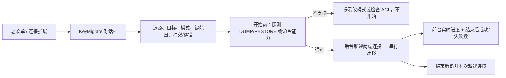
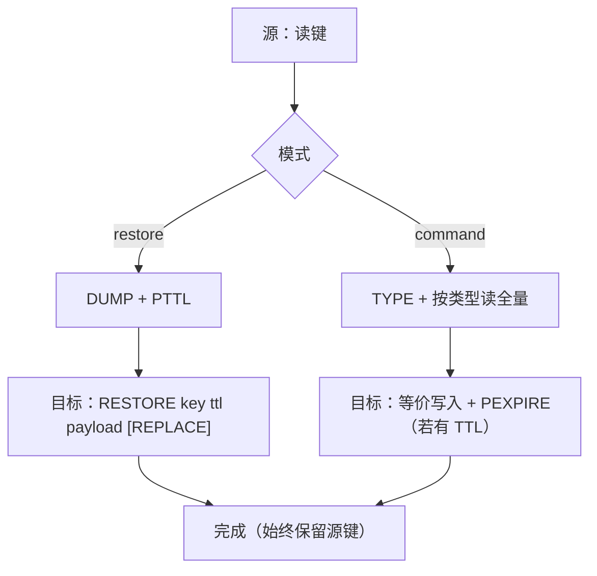

# 37. 多连接键迁移（源 ↔ 目标）

> **实现状态**：P0 已实现（可手测）  
> **关联 backlog**：[`future.md`](../../docs/zh/changelog/future.md) L4「多个 Redis 连接之间的键迁移」  
> **可复用能力**：批量导出/导入（[`09_command-export-format.md`](./09_command-export-format.md)、`KeyBatch.vue`、`ops/exp.rs` / `ops/imp.rs`）、单键命令化（`ops/cmd.rs` `key_as_command_lines`）、同连接跨 slot `DUMP+RESTORE`（`me_cluster.rs`）、进度事件 `ExportImportEvent`、顶栏扩展菜单（[`KeyHeader.vue`](../../src/views/KeyHeader.vue)）  
> **关键代码（预期）**：新建 `client/ops/migrate.rs` + `KeyMigrate.vue`；`api.rs` `migrate_keys` / 能力探测；`KeyHeader.vue` 总菜单入口；`KeyMain.vue` 连接扩展菜单入口；locales

> 目标：在两个 Redis 连接之间**直接复制键**（不删源），无需「先导出文件再导入」。入口：总菜单「键迁移」（**新窗口下面**；选任意已保存连接，源/目标**一律后台新建连接、结束后断开**）与连接扩展菜单（可带勾选键、源锁定）。传输仅 **RESTORE** / **命令**，默认 RESTORE；开始前探测。键范围对齐导出。冲突仅跳过/覆盖。前台显示进度；结束提示成功/失败个数。TTL 固定保留。

---

## 一、问题与边界

### 1.1 现状缺口

| 已有能力                         | 还缺什么                                       |
| -------------------------------- | ---------------------------------------------- |
| 同连接 `COPY` / 重命名           | 跨**连接**（不同主机 / 实例）                  |
| 导出 CSV（DUMP）或 CMD → 再导入  | 中间文件、两步操作；无「选目标连接」一站式流程 |
| 集群同实例跨 slot `DUMP+RESTORE` | 目标是另一套连接状态机                         |

用户典型场景：

1. 开发库 → 测试库 / 本地 → 远程，搬一批键做联调
2. Redis 大版本升级前后（如 6.x → 7/8.x），RDB 序列化不兼容，改用命令方式
3. 单机 → 集群、集群 → 单机（键粒度经客户端中转，不依赖服务端 `MIGRATE`）

### 1.2 明确不做（首版）

| 项                               | 原因                                                                      |
| -------------------------------- | ------------------------------------------------------------------------- |
| Redis 原生 `MIGRATE`             | 要求源节点直连目标（防火墙 / Docker / AUTH / TLS 常失败）；GUI 中转更可控 |
| 「自动」选 restore/command       | 易误解；改为用户二选一 + 开始前探测                                       |
| TTL 策略选项                     | 固定**保留源 TTL**，界面不出现                                            |
| 迁完删源（移动）                 | 只做复制；避免误删                                                        |
| 冲突「中止」选项                 | 只要跳过 / 覆盖，简单点                                                   |
| 按目标「只读」过滤               | 不做特殊处理，写失败记入失败数即可                                        |
| 复用顶栏已打开连接做迁移         | **一律后台新建**专用连接，结束后断开，避免搅乱当前会话                    |
| RedisSearch 索引 / 别名 / 同义词 | 不是普通 KV；另案                                                         |
| Stream 消费者组                  | 命令方式只能 `XADD` 条目                                                  |
| 任务队列持久化 / 断点续传        | 首版单次任务                                                              |

---

## 二、入口与形态

### 2.1 两个入口

| 入口                   | 位置                                                                                                           | 行为                                                                                        |
| ---------------------- | -------------------------------------------------------------------------------------------------------------- | ------------------------------------------------------------------------------------------- |
| **总菜单「键迁移」**   | 顶栏操作下拉（[`KeyHeader.vue`](../../src/views/KeyHeader.vue)），**紧挨「新窗口」下面**；**无当前连接也可点** | 打开独立对话框：自选**源连接 + 目标连接**（及 DB）；键范围用 MATCH / 整库（无勾选键上下文） |
| **连接扩展「键迁移」** | 当前连接键区扩展菜单（与「导出 / 导入」并列，[`KeyMain.vue`](../../src/views/KeyMain.vue)）                    | **源锁定当前连接（不可改）**；可带入**已勾选键**；目标自选；键范围同导出                    |

> 对话框建议独立组件 `KeyMigrate.vue`（挂 `AppMain` / `KeyHeader` 或 `KeyMain`），不要硬塞进 `KeyBatch` 的 export/delete 模式，以免「双连接 + 探测」把批量框撑乱。键范围交互（勾选 / match / 预览扫描）可**对照** `KeyBatch` 抄一版精简 UI。

### 2.2 连接选择（不必事先打开；一律新建）

- 下拉数据源：已保存的 `connList`（全部连接配置），**不限**当前是否已打开。
- 点「开始」时：源、目标**一律后台新建专用连接**（即使用户顶栏已经打开同一配置，迁移也不复用那条会话），不挤进顶栏连接列表。
- **生命周期**：任务结束（成功 / 失败 / 取消）后，**这两条后台连接一律断开**。顶栏里用户自己打开的连接完全不动。
- **不考虑**目标是否只读：不做过滤；若实际无写权限，写入失败计入失败数即可。
- **源与目标同一连接配置且同一 DB**：拒绝。
- **同一连接配置不同 DB**：允许（统一走迁移管线）。



---

## 三、传输方式

### 3.1 仅两档（默认 RESTORE）



| 方式                | 做法                                            | 优点                                 | 缺点 / 风险                                   |
| ------------------- | ----------------------------------------------- | ------------------------------------ | --------------------------------------------- |
| **RESTORE**（默认） | 源 `DUMP` → 客户端中转 → 目标 `RESTORE`         | 快；保留内部编码；模块键 DUMP 通即可 | RDB 版本不兼容会失败；整键进客户端内存        |
| **命令**            | 按类型读出 → 目标侧重建（对齐现有命令导出能力） | **跨版本友好**；易排错               | 慢；大集合内存大；部分类型有上限/近似（见下） |

> 不走中间文件。逻辑 ≈ 内存中的 export + import。

### 3.2 开始前探测（替代「自动模式」）

用户选好模式后点「开始」→ **先探测，再扫键/迁移**。

| 所选模式    | 探测内容（建议）                                                                                          | 失败时                                                                          |
| ----------- | --------------------------------------------------------------------------------------------------------- | ------------------------------------------------------------------------------- |
| **RESTORE** | 源：命令是否存在 / ACL 是否允许 `DUMP`（如 `COMMAND INFO DUMP` 或对探测键策略见下）；目标：`RESTORE` 同理 | **阻断开始**，明确提示「当前连接不支持 DUMP/RESTORE，请改用命令方式或检查 ACL」 |
| **命令**    | 源至少能 `TYPE`；可选对常见写命令做 `COMMAND INFO`（不必过重）                                            | 阻断或警告                                                                      |

探测注意：

- **避免**往目标写入探测键（有副作用）；优先 `COMMAND INFO` / `ACL` 类只读探测。
- 若环境无法 `COMMAND INFO`（极老版本）：可降级为「开始后首键失败再按遇错策略处理」，UI 旁注探测不完整。
- RDB **版本**是否兼容：探测阶段通常测不出来；RESTORE 首键若报序列化错误，文案提示「可改用命令方式重试」。**不会**在失败后自动切模式（避免半成功语义不清）。

### 3.3 类型覆盖与已知限制

| 类型                      | restore       | command（复用 `key_as_command_lines` 能力）   | 备注                                 |
| ------------------------- | ------------- | --------------------------------------------- | ------------------------------------ |
| String/Hash/List/Set/ZSet | ✅            | ✅                                            | 常规                                 |
| Stream                    | ✅            | ✅ 多条 `XADD`（保留 id）                     | **不含** consumer group              |
| JSON                      | ✅*           | ✅ `JSON.SET`                                 | *依赖模块                            |
| Array                     | ✅*           | ✅ `ARMSET`                                   |                                      |
| Vector Set                | ✅*           | ⚠️ `VADD`，导出行数上限 1000；`VEMB` 可能近似 | **超限 → 整键失败**（不写部分成功）  |
| TimeSeries                | ✅*           | ⚠️ `TS.ADD` 有上限；缺 `TS.CREATE` 元数据     | **超限 → 整键失败**；元数据补齐放 P1 |
| 未知 / 模块私有           | ✅ 若 DUMP 通 | ❌                                            | command 记失败                       |

\* 源有模块、目标无同模块 → 失败，属预期。

---

## 四、任务参数（产品面）

### 4.1 源与目标

| 字段     | 说明                                                      |
| -------- | --------------------------------------------------------- |
| 源连接   | 总菜单：必选可改；**连接扩展入口：锁定当前连接，不可改**  |
| 源 DB    | 扩展入口：当前 DB（一般不可改）；总菜单：支持多 DB 时可选 |
| 目标连接 | 必选；与源同配置同 DB 时禁用开始（**不**按只读过滤）      |
| 目标 DB  | 支持时可选；默认 0 或与源同号                             |

### 4.2 键范围（对齐导出 / KeyBatch）

与现有导出一致，三种来源：

| 范围       | 说明                                                                                           |
| ---------- | ---------------------------------------------------------------------------------------------- |
| **勾选键** | 连接扩展入口：键列表已勾选则带入，可直接开始（与导出「已选键」相同）                           |
| **MATCH**  | 输入 pattern（如 `user:*`）；可先「查看」续扫列出键再迁（复用 KeyBatch 扫描交互）              |
| **整库**   | match 为 `*`（或空并约定为全库）；危险操作，开始前二次确认，并展示将处理的键数量（扫描完成后） |

总菜单入口无勾选上下文 → 只提供 MATCH / 整库。  
连接扩展入口：有勾选则走勾选；无勾选则与导出一样可填 MATCH / 整库。

### 4.3 冲突策略（目标已存在）

仅两档，**无「中止」**：

| 策略             | restore                        | command                                   |
| ---------------- | ------------------------------ | ----------------------------------------- |
| **跳过**（默认） | 不带 REPLACE；BUSYKEY → ignore | 先 `EXISTS`，存在则 ignore                |
| **覆盖**         | `RESTORE … REPLACE`            | 先 `DEL` 再写入（避免 Hash 字段残留合并） |

### 4.4 遇错是否继续

| 策略             | 行为                                               |
| ---------------- | -------------------------------------------------- |
| **继续**（默认） | 单键失败记 err + 失败列表，继续下一键              |
| **遇错即停**     | 第一次非「跳过类」错误后停止；已成功的键保留在目标 |

失败原因示例：RDB 不兼容、WRONGTYPE、OOM、类型不支持、命令导出行数超限、源键已消失。

### 4.5 TTL（无 UI）

固定 **保留源 TTL**：

- restore：`PTTL` → `RESTORE` 的 ttl（毫秒；≤0 则 0=永久）
- command：写入后若 `PTTL>0` 再 `PEXPIRE`

不做永久/自定义选项；不做 `ABSTTL`。

### 4.6 复制语义

始终**保留源键**；无「迁完删源」。

### 4.7 可延后选项

| 选项                | 优先级 | 说明                          |
| ------------------- | ------ | ----------------------------- |
| 键名前缀/后缀       | P1     | 只改目标名                    |
| 失败列表导出 / 重试 | P1     |                               |
| 大键阈值告警        | P1     | `MEMORY USAGE` 超阈确认或跳过 |
| TimeSeries 元数据   | P1     | `TS.CREATE` 等                |
| `IDLETIME` / `FREQ` | P2     | 仅 restore                    |
| 限速 / 并发         | P2     | 首版串行                      |

---

## 五、决策摘要

| 项             | 结论                                                                                     |
| -------------- | ---------------------------------------------------------------------------------------- |
| 入口           | ① 总菜单「键迁移」（**新窗口下面**）；② 连接扩展「键迁移」（可带勾选键；**源锁定当前**） |
| 建连           | 不必事先打开；源/目标**一律后台新建**专用连接；**结束后全部断开**；顶栏已开连接不动      |
| 只读目标       | **不特殊处理**                                                                           |
| 传输           | 仅 `restore` / `command`；**默认 restore**                                               |
| 探测           | 开始前探测所选模式所需命令；不支持则阻断并提示改模式                                     |
| 自动模式       | **不做**                                                                                 |
| 冲突           | 仅 `skip` / `replace`（默认 skip）；**无 abort**                                         |
| 遇错           | `continue` / `stop`；默认 continue                                                       |
| TTL            | **固定保留**；无选项                                                                     |
| 删源           | **不做**（只复制）                                                                       |
| 键范围         | 勾选 / MATCH / 整库（对齐导出，P0 都做）                                                 |
| VSet / TS 超限 | **整键失败**（不部分写入）                                                               |
| 进度           | **前台显示传输进度**（事件驱动）；可取消                                                 |
| 结束提示       | **成功 N 个、失败 M 个**（跳过可单独计或并入说明）                                       |
| 原生 MIGRATE   | 不做                                                                                     |

---

## 六、技术设计要点

### 6.1 API 草图

```text
migrate_keys(param: RedisMigrateParam) -> ()   // 立即返回，进度走事件
migrate_probe(param: RedisMigrateProbe) -> MigrateProbeResult  // 开始前调用

RedisMigrateParam {
  source_conn_id: String,   // 配置 id；后端一律新建专用连接，不用顶栏会话
  target_conn_id: String,
  source_db: u16,
  target_db: u16,
  pattern: String,          // 与导出一致；有 key_list 时可不依赖
  key_list: Vec<RedisKey>,  // 勾选键；空则按 pattern 扫
  mode: String,             // restore | command
  handle_conflict: String,  // skip | replace
  on_error: String,         // continue | stop
}

RedisMigrateProbe {
  source_conn_id, target_conn_id, mode
}

MigrateProbeResult {
  ok: bool,
  mode: String,
  message: String,          // 失败时给用户看的原因
}
```

进度：新建 `EVENT_MIGRATE`（或复用 `ExportImportEvent`：`ok_count` / `err_count` / `ignore_count` / `total_count` / `finished`），可加 `current_key`。前端**必须**实时展示进度条或计数（对齐导出导入进度体验）。取消用 `AtomicBool`。

结束时前端明确提示：**成功 N 个键，失败 M 个键**（若有跳过：成功 / 跳过 / 失败分列或文案带上 ignore）。

### 6.2 后端管线（串行）

1. **新建**源、目标专用连接；校验非同配置同 DB
2. `migrate_probe` 已通过（前端先调或后端开始时再检一次）
3. 解析键列表：有 `key_list` 用勾选；否则按 `pattern` SCAN（`*` = 整库）
4. 逐键处理并推送进度事件：
   - **restore**：`DUMP` + `PTTL` → 目标 `RESTORE`（冲突策略）
   - **command**：读 payload / 或 `key_as_command_lines` 后在目标执行 → 按需 `PEXPIRE`
5. 按 `on_error` 决定是否停止（冲突只有 skip/replace，无 abort）
6. emit finished（**不** DEL 源）
7. **断开**本次新建的源、目标连接

**命令模式怎么写到目标**：采用 **KeyPayload 结构化读写**（`ops/migrate_payload.rs`）——源侧按类型读成内存结构，目标侧直接 `SET`/`HSET`/`RPUSH`/…，**不**再拼 redis-cli 文本再解析（避免大键 `\xHH` 膨胀卡死）。界面仍只显示「RESTORE / 命令」。

### 6.3 集群 / 代理 / SSH

- 两端各自走现有 `MeClient`，按键路由；迁移层不算 slot
- 不依赖源 Redis 网络访问目标 Redis（含 SSH/代理场景）

### 6.4 大键与内存

DUMP / `HGETALL` / `LRANGE 0 -1` 整键进 RedisME 进程；首版串行；大键阈值告警放 P1。

### 6.5 安全与日志

- 不做只读预检；无写权限等错误记入失败数
- 命令日志：建议汇总一条「migrate N keys → target」+ 成功/失败摘要，避免刷屏

### 6.6 与导出导入的关系

| 场景                       | 建议                 |
| -------------------------- | -------------------- |
| 两边都能连上、要一站式复制 | **键迁移**           |
| 要文件、给别人、可编辑     | 导出 CMD/CSV         |
| 迁移失败要线下改           | P1：失败键导出为命令 |

迁移**不替代**文件导入导出。

---

## 七、UI 草图

### 7.1 总菜单项

在 [`KeyHeader.vue`](../../src/views/KeyHeader.vue) 操作下拉中，**放在「新窗口」下面**：

```text
…（当前连接：重载 / 关闭 / 命令日志）
────────
新窗口
键迁移          ← 新增；紧挨新窗口下方；无当前连接也显示
────────
设置
关于
```

### 7.2 连接扩展菜单

与导出/导入并列：

```text
导出数据
导入数据
键迁移          ← 新增
…
```

有勾选键时打开对话框并带入 `keyList`；无勾选则 `match` 可填。

### 7.3 对话框一屏字段

```text
源连接:   [下拉 / 或锁定只读展示]   源 DB: [ ]
目标连接: [下拉 已保存连接]           目标 DB: [ ]
          （扩展入口：源连接禁用，仅显示当前名）

传输方式: (• RESTORE  ○ 命令)
          旁注：版本差大或 RESTORE 探测失败时请用「命令」

键范围:   （有勾选时显示「已选 N 个键」）
          MATCH: [          ]   [查看/扫描…]
          或整库（*）— 开始前确认

冲突:     (• 跳过  ○ 覆盖)
遇错:     (• 继续  ○ 停止)

[取消]  [开始]   ← 开始先探测，不通过则 toast/对话框说明，不进入进度
```

**进行中（前台必显）**：进度条或 `已处理 / 总数`，并显示成功 / 跳过 / 失败计数 + 当前键；可取消。  
**结束必提示**：`迁移完成：成功 N 个，失败 M 个`（有跳过时带上「跳过 K 个」）；可选展开失败列表。

---

## 八、风险与测试要点

| 风险                        | 缓解                                                   |
| --------------------------- | ------------------------------------------------------ |
| RDB 不兼容                  | 默认 restore；失败文案引导改「命令」重试；不自动切模式 |
| 后台新建连接失败            | 探测/开始阶段明确报错（密码、网络、SSH）               |
| Stream / TS / Vector 不完整 | 注明限制；**超限整键失败**，不部分成功                 |
| 目标已存在 + command 覆盖   | 先 DEL 再写                                            |
| 整库误操作                  | 二次确认 + 显示键数量                                  |
| 取消                        | 当前键写完再停（单命令原子）                           |

手测矩阵：

- 总菜单无打开连接 → 选两端 → restore / command
- 连接扩展 + 勾选键；MATCH；整库确认
- 探测：ACL 禁 DUMP → 阻断
- 冲突跳过/覆盖 × 遇错继续/停止
- 集群 ↔ 单机；取消中途；二进制键名
- 结束文案：成功/失败（及跳过）数量正确；后台连接已断开、顶栏会话仍在

---

## 九、分期

### P0

- 总菜单（新窗口下）+ 连接扩展两个入口（扩展入口源锁定）
- 选任意已保存连接；源/目标**一律后台新建**，**结束后断开**
- `restore` / `command`，默认 restore；开始前探测
- 键范围：勾选 / MATCH / 整库（对齐导出）
- 冲突仅跳过/覆盖；遇错继续/停止；TTL 固定保留；不删源；VSet/TS 超限整键失败
- 命令模式：KeyPayload 结构化读写（不经文本）
- **前台传输进度**；结束提示成功/失败个数；可取消

### P1

- 键名前缀；失败导出与重试；大键阈值
- TimeSeries 元数据尽量带上

### P2

- IDLETIME/FREQ；限速；原生 MIGRATE 高级选项；任务历史

---

## 十、已拍板（原开放问题）

| 项               | 结论                                                               |
| ---------------- | ------------------------------------------------------------------ |
| 建连策略         | **一律后台新建**专用连接（不复用顶栏已开会话）；**结束后全部断开** |
| 只读目标         | **不特殊处理**                                                     |
| 扩展入口源连接   | **不能改**（锁定当前）                                             |
| 总菜单位置       | **新窗口下面**                                                     |
| 冲突选项         | 仅 **跳过 / 覆盖**                                                 |
| VSet / TS 超限   | **整键失败**                                                       |
| 命令模式写入实现 | **KeyPayload 结构化读写**（不经文本命令）                          |
| 进度与结果       | **前台显示传输进度**；结束提示 **成功 N / 失败 M**                 |

---

## 十一、与 backlog 的对应

落地后将 [`future.md`](../../docs/zh/changelog/future.md)「多个 Redis 连接之间的键迁移」移入已完成；changelog 写清：总菜单（新窗口下）与连接扩展入口、后台专用连接、RESTORE/命令两档与探测、勾选/MATCH/整库、跳过/覆盖、进度与成功/失败数提示。
